# لوحة إدارة التراث على iPhone Duo — الامتداد الكامل والتكيّف (13 نوفمبر 2026)

النطاق طبقة العرض فقط:
- ملف جديد [src/duo-adaptive.css](../src/duo-adaptive.css) يُحمَّل آخر الأوراق في [src/main.tsx](../src/main.tsx).
- شاشة ما قبل التحميل في [index.html](../index.html).
- نافذة تعليمات التثبيت في [src/components/Login.tsx](../src/components/Login.tsx).
- معالج تغيّر حجم النافذة في [src/App.tsx](../src/App.tsx).
- أزرار تصفية العملاء في [src/components/CustomerPage.tsx](../src/components/CustomerPage.tsx).

لم يُمَس الخادم ولا المصادقة ولا Firestore ولا الوضع التجريبي ولا المدفوعات ولا ملفات النشر.

رموز الحالة: `PASS` تحققٌ رأيته أو اختبرته، `PARTIAL` جزئي، `FAIL` خلل باقٍ، `BLOCKED` يحتاج جهازًا أو إذنًا، `NOT_APPLICABLE` غير ذي صلة، `NOT_TESTED` لم يُختبر.

## 1. نوع المشروع ومسار العرض

- **الويب:** React 19 + Vite 6 + Tailwind 4، ويخدمه Express ([server.ts](../server.ts)) على Cloud Run خلف Firebase Hosting. تتراكم أوراق CSS فوق بعضها: `index.css` ثم ملفات `dna/*` ثم `motion` ثم `quality` ثم `beauty2` ثم `polish-r4`. أُضيف `duo-adaptive.css` في آخرها، فلم أعدّل الطبقات القديمة.
- **الشاشات:** شاشة ما قبل التحميل (`#preboot-splash`)، ثم شاشة الإقلاع (`.ktk-boot`)، ثم الدخول (`.admin-login-showcase`)، ثم الهيكل (`.admin-heritage-shell`: شريط علوي، وقائمة جانبية تصبح درجًا تحت 1024px، ومنطقة محتوى قابلة للتمرير).
- **iOS:** يوجد مجلدا `apple/` و`apple-release/` لغلاف أصلي، ولم يُبنَيا في هذه الجولة (`NOT_TESTED`).
- **مرجع العمل:** لم أجد الملف `00_MASTER_CLAUDE_CODE_AR.txt` على سطح المكتب وقت التنفيذ. فعملت بـ `RUN_2026-11-13.md` و`DUO_BRIEF.md` و`BEAUTY_BRIEF.md`، وببنية الوضعيات A–J المعتمدة في جولة Orbit الشقيقة.

## 2. خط الأساس قبل التعديل (`origin/main` = `f6da715`)

| الفحص | النتيجة |
|---|---|
| `npm ci` | PASS |
| `npm run lint` (`tsc --noEmit`) | PASS |
| `npm test` | PASS: 178/178 (22 ملفًا) |
| `npm run build` (ومعه verify:pwa وverify:demo-entry) | PASS |
| `npm run build:server` | PASS |
| مصفوفة WebKit: 13 مقاسًا × 6 شاشات | لا تمرير أفقي، ولا عناصر خارج الشاشة، ولا أخطاء JS. وظهرت العيوب المذكورة في القسم 3 |

لم يكن على `main` أي فشل سابق.

## 3. ما وُجد وما أُصلح من جذوره

| # | العَرَض (قبل) | الجذر | الإصلاح |
|---|---|---|---|
| 1 | شاشة الإقلاع على 600×350 (مطوي عرضي) و951×350 و852×393: البطاقة (620px) أطول من النافذة، فيُقص الشعار من الأعلى وسطر الحالة من الأسفل، ولا يمكن التمرير | حاوية `fixed` مع `align-items:center` و`overflow:hidden`، فتفيض البطاقة من الجهتين | الحاوية تتمرر (`overflow-y:auto`)، والبطاقة `margin:auto` فتتوسط ولا يخرج أعلاها من النافذة أبدًا. وحين يكون الارتفاع ≤520 والعرض ≥560 تصير البطاقة أفقية: الشعار بجانب النص. طُبّق الشيء نفسه على `#preboot-splash` في `index.html` حتى يبقى الانتقال منه إلى React بلا قفزة |
| 2 | الدخول على 600×350 و852×393: لوحة العلامة مكدسة فوق النموذج، فيبدأ زر Google عند y=432، تحت حافة الشاشة | التكديس العمودي مربوط بالعرض فقط (<900px)، ولا يأخذ الارتفاع في الحسبان | حين يكون الارتفاع ≤520 والعرض ≥560، تجلس العلامة والنموذج جنبًا إلى جنب، وتُخفى مؤشرات الزينة الثلاثة، ولكل لوحة زواياها الخارجية. صار زر Google عند y=108 على 600×350، وy=118 على 852×393، وy=90 على 951×350 |
| 3 | نافذة «تثبيت التطبيق» التي تفتح تلقائيًا في Safari على 600×350: العنوان والزر «حسناً، فهمت» مقصوصان، ولا تمرير | الغطاء يوسّط البطاقة بـ flex دون تمرير | الغطاء `overflow-y-auto` والبطاقة `my-auto`، فتتمرر حين لا تتسع. وعلى الارتفاع القصير صارت أضيق حشوًا، وأعرض حين يتوفر العرض. وأُضيف `role="dialog"` و`aria-modal`. صارت البطاقة كلها داخل الشاشة (16→336 من 350) |
| 4 | J: فتح الدرج الجانبي ثم تغيّر الارتفاع وحده (طيّ شريط Safari، أو لوحة مثبتة، أو تبديل Split View) يغلق الدرج | معالج `resize` يضبط `sidebarOpen` في **كل** حدث، حتى حين لا يتغير العرض | لا يُعاد ضبط الدرج إلا حين تعبر النافذة خط 1024px فعلًا. تحقق WebKit: قبل الإصلاح صار الدرج `inert` واختفى غطاؤه بعد 880→520، وبعده بقي مفتوحًا بعد 880→520 ثم بعد 669→470 |
| 5 | أزرار تصفية العملاء (الكل، كبار العملاء…) وقائمة الانطباع ارتفاعها 33–37px من 600px فما فوق | `sm:min-h-0` يفترض أن 640px فأكثر تعني فأرة، وهذا افتراض جهاز لا مساحة | `pointer-fine:min-h-0`: الشاشات اللمسية تحتفظ بـ 44px في كل عرض، والفأرة تبقى كما كانت. تحذيرات الأهداف الصغيرة في صفحة العملاء نزلت من 11 إلى 6 على 669 و951 و852 |
| 6 | لا تعامل مع المفصل: في وضع الكتاب يعبر عنوان الدخول ونصّه وأزراره الثلاثة خط الطي، وفي الطاولة تعبر بطاقة الإقلاع خط الطي | لا يوجد تحسين تدريجي لـ Viewport Segments | `@media (horizontal-viewport-segments: 2)`: لوحة العلامة في صفحة والنموذج في الأخرى، والفاصل بينهما بعرض المفصل بالضبط (`env(viewport-segment-*)`)، وبطاقة الإقلاع في الصفحة الأولى. وفي `vertical-viewport-segments` تصير بطاقة الإقلاع المضغوطة في النصف العلوي. دون الـ API لا تُطبَّق هذه الكتل أبدًا |

**ما فحصته ولم أغيّره عمدًا:**
- الشريط الداكن/الذهبي على الحافة اليمنى في لقطات WebKit هو شريط تمرير مُنسَّق يرسمه WebKit على macOS. iOS لا يرسم أشرطة التمرير المنسقة، فهو أثر للمحاكاة لا خلل.
- في الوضع التجريبي على الارتفاع القصير (600×350) يبقى للمحتوى نحو 164px فقط، لأن شريط النسخة التجريبية (64px) وسطر محدد الفترة (62px) محجوزان أسفل الشاشة. هذا التخطيط خاص بالنسخة التجريبية، وقررته جولات سابقة (#134–#140) ثم أعيد النظر فيه. الحساب الحقيقي لا يحجز هذا الشريط (`--bs:0;--dock:0`، [beauty2.css](../src/beauty2.css) قسم «Floating buttons back in their corners»)، والأزرار تعود إلى زواياها. لم ألمسه، لأن تغييره يعني إعادة تصميم طبقة الأزرار العائمة كلها (`PARTIAL`، القسم 10).

## 4. فحص الامتداد الكامل

| البند | الحالة | الدليل |
|---|---|---|
| خلفية الجذر | PASS | `html`/`body` بلون الإقلاع الداكن أثناء التحميل، والهيكل `h-[100dvh]` بخلفية ممتدة |
| الحواف الأربع وحواف الأمان | PASS (محاكاة) | `viewport-fit=cover`. الإقلاع وما قبله يحسبان `env(safe-area-inset-*)` لكل جهة، والدخول القصير كذلك. حواف Playwright صفر، فلم تُقَس على جهاز |
| عمود أزرار Safari الجانبي (المطوي) | NOT_APPLICABLE للكود | Safari يمدد لون الخلفية فقط |
| تمرير أفقي | PASS | 0 في 13 مقاسًا × 6 شاشات (WebKit)، وفي محاكاة المفصل (Chromium) |
| `overflow:hidden` يقص المحتوى | PASS بعد الإصلاح | حاويتا الإقلاع صارتا تتمرران، ونافذة التثبيت كذلك |
| لوحة المفاتيح | NOT_TESTED | المحاكاة لا تُظهر لوحة مفاتيح حقيقية. والإصلاح 4 يمنع إغلاق الدرج حين تتغير الارتفاعات بسببها |

## 5. مصفوفة الوضعيات A–J

المنصة: Playwright WebKit (build 2370)، بـ UA لـ Safari على iPhone، وDPR 2، ولمس، وتقليل الحركة. الشاشات: الإقلاع/الدخول، ولوحة القيادة، والطلبات، والعملاء، وسجل الفواتير، والإعدادات (عبر `?demo=1&page=…`).

| الوضعية | المقاس | الإقلاع | الدخول | الشاشات الداخلية | الحالة |
|---|---|---|---|---|---|
| A مطوي طولي | 382×580 | ✓ (بلا تغيير) | ✓ | بلا تمرير أفقي | PASS (محاكاة) |
| B مطوي عرضي | 600×350 | كان مقصوصًا، وصار بطاقة أفقية كاملة | كان الزر تحت الحافة، وصار جنبًا إلى جنب | بلا تمرير أفقي. التجريبي يترك 164px للمحتوى | PASS للإقلاع والدخول، PARTIAL للتجريبي |
| C مفتوح طولي | 669×880 | ✓ | ✓ | العملاء عمودان، ولا تمرير أفقي | PASS (محاكاة) |
| C مع لوحة مثبتة | 669×520 | ✓ | ✓ | الدرج لم يعد يُغلق عند تغير الارتفاع | PASS (محاكاة) |
| D مفتوح عرضي | 951×600 | ✓ | ✓ عمودان (بلا تغيير) | ✓ | PASS (محاكاة) |
| D مع لوحة مثبتة | 951×350 | كان مقصوصًا، وصار كاملًا | يتسع كله (357/350) | ✓ | PASS (محاكاة) |
| E كتاب | 669×880 + مفصل x=334 | 0 عناصر تعبر (كان 2) | 0 تعبر (كان 5) | الشاشات الداخلية لم تُكيَّف للمفصل | PASS للإقلاع والدخول في **محاكاة Chromium** (`displayFeature`)، وPARTIAL للداخلية. على الجهاز BLOCKED: الـ API خلف علم في Safari 27.1 |
| F طاولة | 951×600 + مفصل y=300 | 0 تعبر (كان 2) | — | — | PASS في محاكاة Chromium، وBLOCKED على الجهاز |
| G نافذتان | 385×571 | ✓ | ✓ | ✓ | PASS (محاكاة) |
| H Split | 320 / 470 / 620 ×600 | ✓ | ✓ | ✓ بلا تمرير أفقي | PASS (محاكاة) |
| I خيمة/حامل | — | — | — | — | NOT_TESTED: لا runtime يعلن هذه الوضعية |
| J انتقال حي | 951→669→470→382→594→951 دون إعادة تحميل | — | — | النص المكتوب في بحث الطلبات بقي، ولا تمرير أفقي، و0 أخطاء. الدرج المفتوح يبقى مفتوحًا بعد تغير الارتفاع (كان يُغلق) | PASS (محاكاة) |

مقاسات إضافية: iPhone 15 (393×852)، وعرضيًا (852×393)، و1440×900. كلها بلا تمرير أفقي. وعلى 852×393 صار زر الدخول داخل الشاشة.

**الدخول على الجهاز المحلي:** خادم المعاينة لا يملك `/api`، فتبقى الشاشة على الإقلاع. لذلك اختُبرت قواعد الدخول بحقن `duo-adaptive.css` في صفحة الدخول الحية (قراءة فقط، دون تسجيل دخول)، واختُبر كود الإقلاع ونافذة التثبيت على البناء المحلي. ويتأكد ذلك بعد النشر على الموقع الحي (القسم 12).

## 6. صور قبل/بعد

| الحالة | قبل | بعد |
|---|---|---|
| B الإقلاع 600×350 |  |  |
| الإقلاع 951×350 |  | 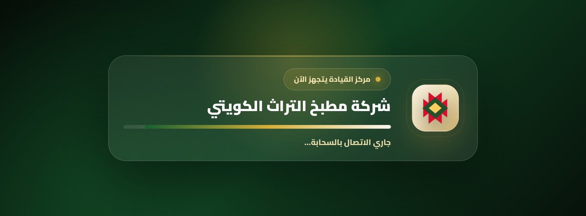 |
| B الدخول 600×350 | 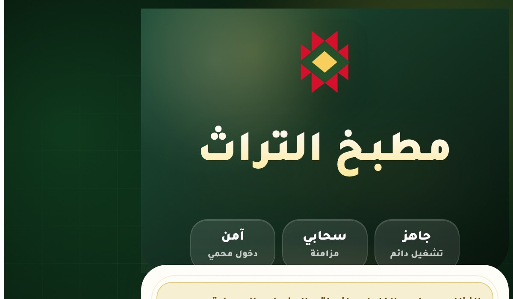 |  |
| B نافذة التثبيت 600×350 | 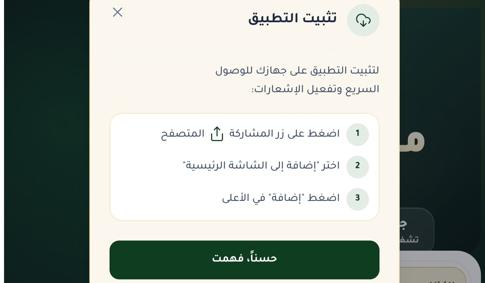 | 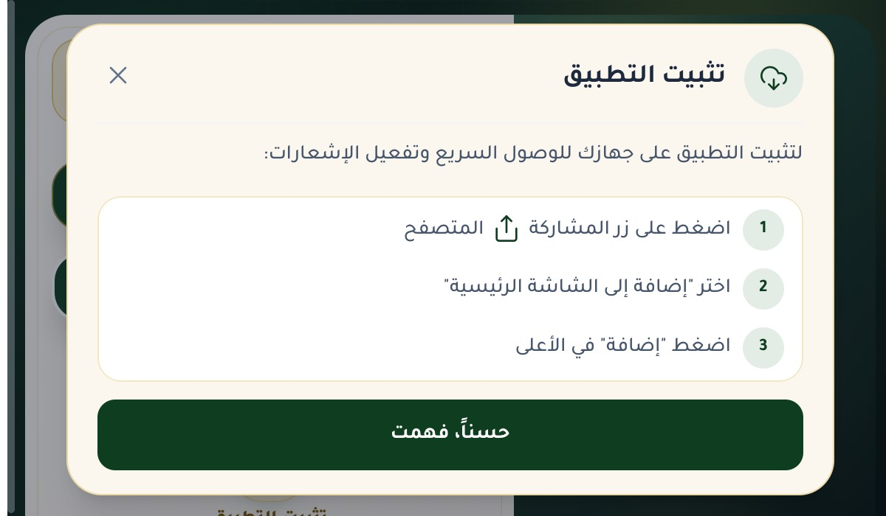 |
| E كتاب، الدخول (محاكاة Chromium) | 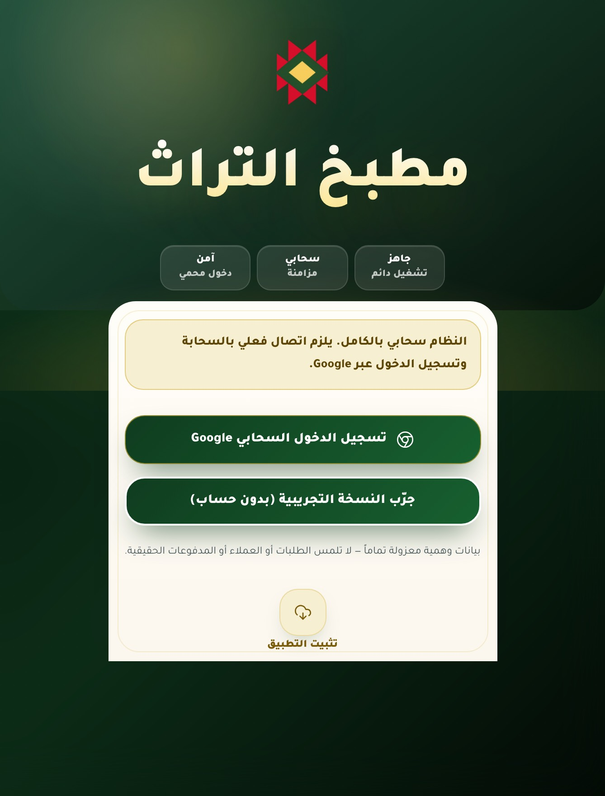 | 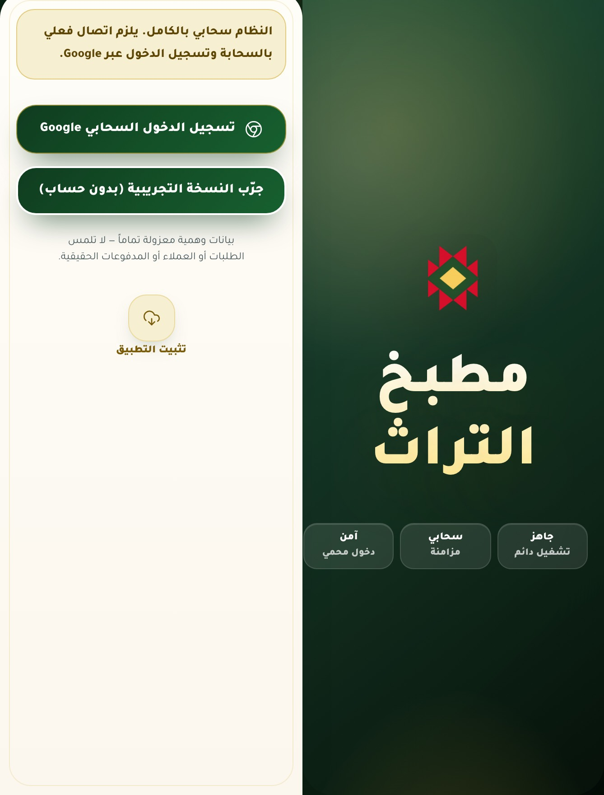 |
| F طاولة، الإقلاع (محاكاة Chromium) |  | 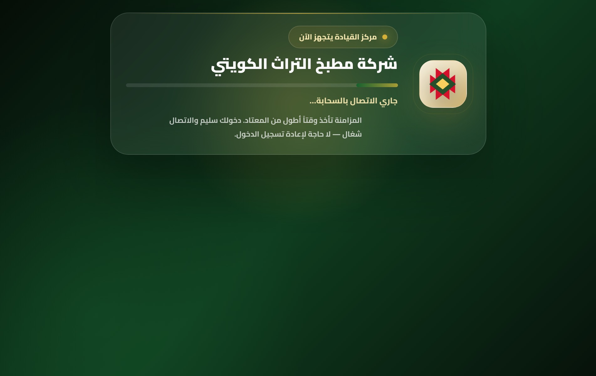 |
| آيفون عرضي 852×393 ودخول 951×350 | | 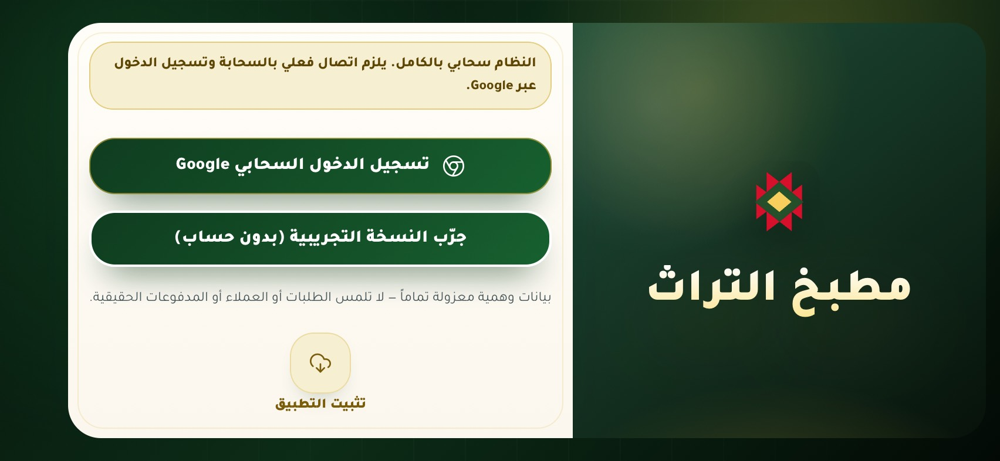  |
| A وC وD وH بعد (بلا تغيير مقصود) | 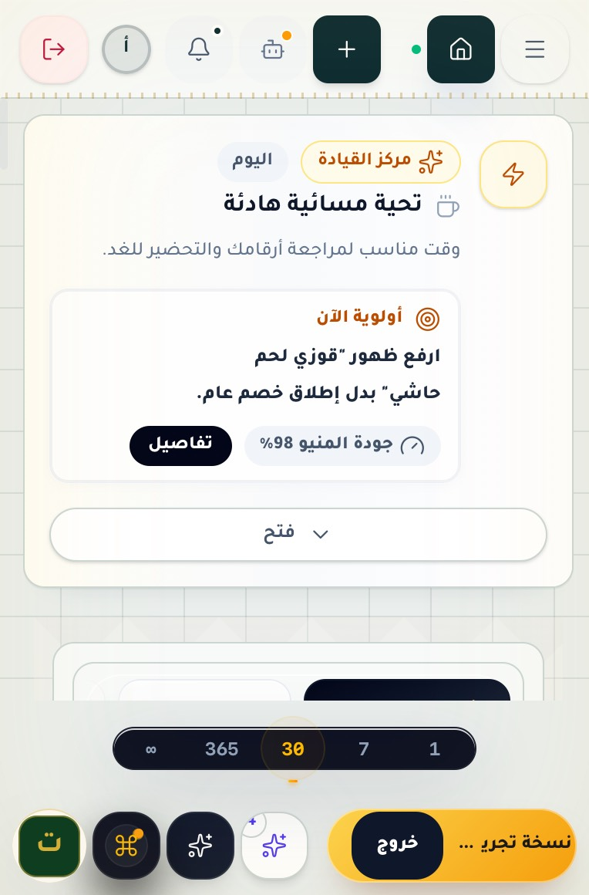 | 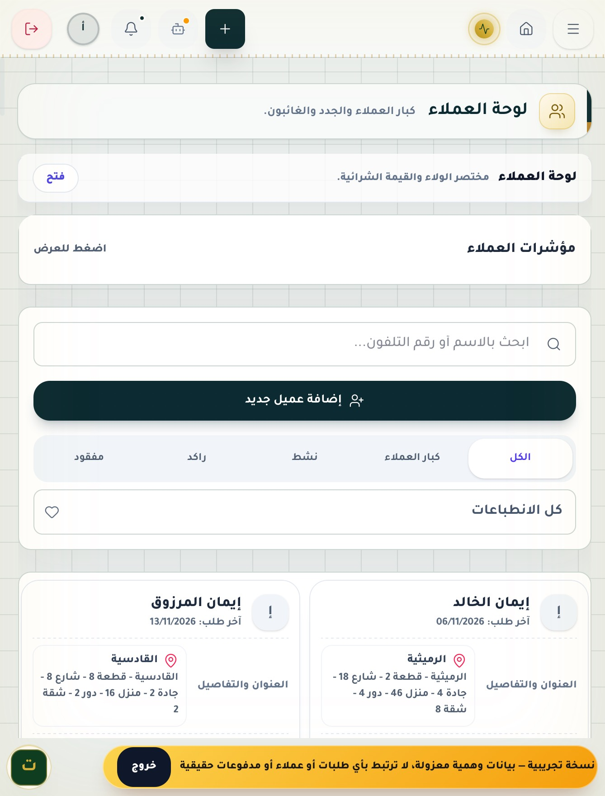 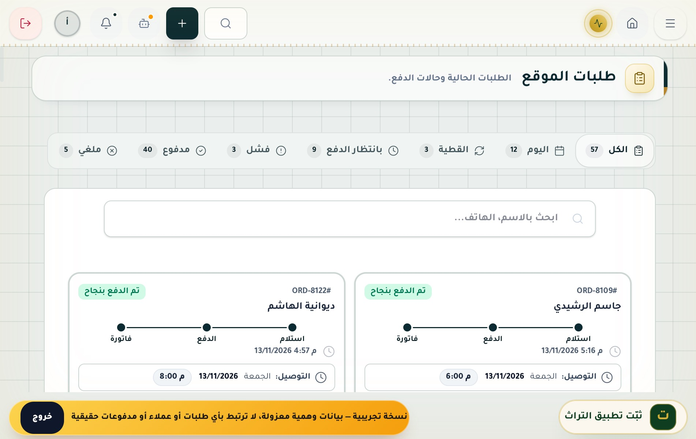 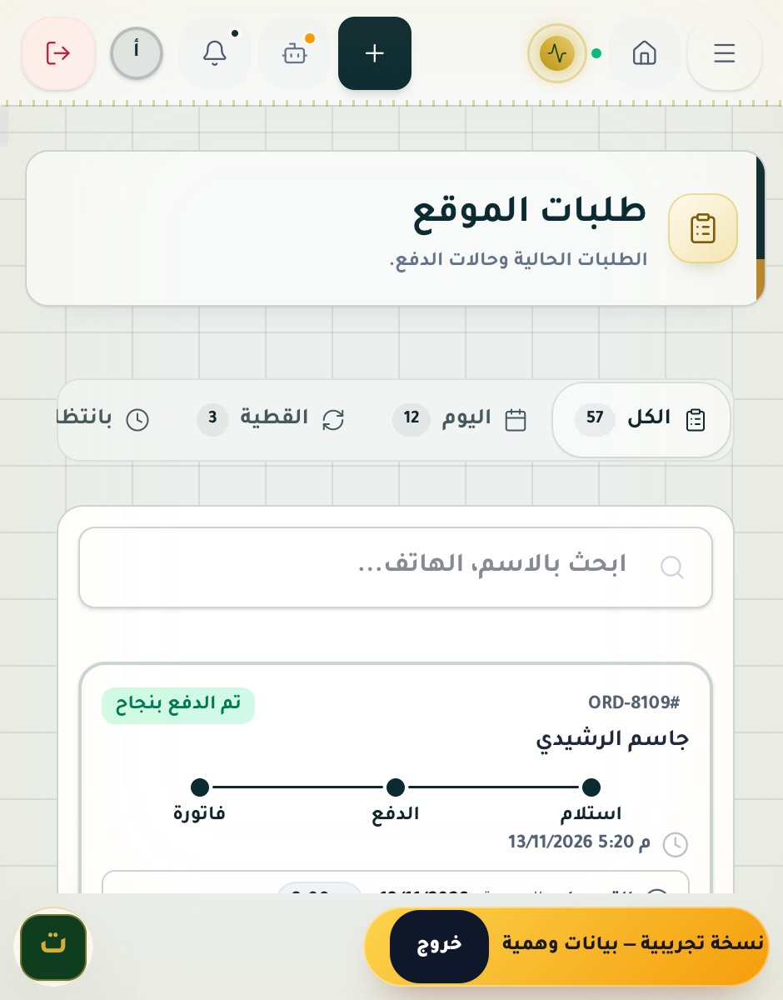 |

## 7. الوصول والاتجاه

- RTL: كل الشاشات `dir=rtl`. في الدخول الجانبي تبقى العلامة على اليمين والنموذج على اليسار، كترتيب العرض الواسع. PASS.
- التكبير غير مقفول (`width=device-width, initial-scale=1.0, viewport-fit=cover`). PASS.
- أهداف اللمس: أزرار تصفية العملاء صارت 44px على اللمس في كل عرض. بقيت أزرار صغيرة سابقة، مثل أزرار 24×44 الجانبية وأسهم 28×60، ولم أتتبعها في هذه الجولة. PARTIAL.
- نافذة التثبيت صار لها `role="dialog"` و`aria-modal="true"` واسم. PASS.
- تقليل الحركة: لم أُضِف حركة جديدة، وحركات الإقلاع تتوقف تحت `prefers-reduced-motion` (قواعد سابقة). PASS.
- VoiceOver حقيقي: NOT_TESTED.

## 8. الأداء

لا JavaScript جديد ولا مراقبين جدد. معالج `resize` صار يتجاهل الأحداث التي لا تعبر الخط، فصار أخف من قبل. أُضيف إلى CSS نحو 5KB غير مضغوطة. لم تُقَس Core Web Vitals (`NOT_TESTED`).

## 9. الاختبارات بعد التعديل

| الأمر | النتيجة |
|---|---|
| `npm run lint` | PASS |
| `npm test` | PASS: 178/178 |
| `npm run build` | PASS، والبناء يحمل قواعد `viewport-segment` و`login-ios-prompt-card` و`@media(pointer:fine)` |
| مصفوفة WebKit (13 × 6) | 0 تمرير أفقي، و0 عناصر خارج الشاشة، و0 أخطاء صفحة. صفحة `settings` تفشل أحيانًا في السكربت بسبب سباق تنقل في السكربت نفسه، وقد حدث قبل التعديل وبعده |
| محاكاة المفصل (Chromium) | الكتاب: الدخول 5→0 والإقلاع 2→0. الطاولة: الإقلاع 2→0 |
| الانتقال الحي (WebKit) | PASS |

## 10. ما بقي مفتوحًا

1. **التجريبي على الارتفاع القصير:** شريط النسخة التجريبية وسطر محدد الفترة يحجزان 126px من 350. الحساب الحقيقي لا يتأثر. الحل الجذري نقل الأزرار العائمة ومحدد الفترة إلى عمود جانبي حين يكون الارتفاع ≤480، كما تقترح آبل للأشرطة العمودية. هذا يمس قرابة 40 قاعدة متراكمة في `beauty2.css`، فتركته لجولة مستقلة. PARTIAL.
2. **الشاشات الداخلية في وضع الكتاب:** قوائم الطلبات والعملاء وغيرها تعبر المفصل عند 669px، فهي عمود أو عمودان لا يعرفان مكان المفصل. يحتاج ذلك إلى تقسيم كل شبكة على `env(viewport-segment-*)`، وتركته لما بعد تفعيل الـ API في Safari. PARTIAL.
3. أهداف لمس صغيرة سابقة (24×44 و28×60) لم تُتتبع. PARTIAL.

## 11. ما يجب فحصه على جهاز حقيقي

1. Safari 27.1: `Viewport Segments` و`Device Posture` خلف علم. فعّله، ثم افتح الدخول نصفيًا كالكتاب: هل العلامة في صفحة والنموذج في الأخرى، والمفصل في الفاصل؟ وفي الطاولة: هل بطاقة الإقلاع في النصف العلوي؟
2. المطوي عرضيًا: هل بطاقة الإقلاع أفقية وكاملة؟ وهل الدخول جنبًا إلى جنب وزر Google ظاهر دون تمرير؟
3. نافذة «تثبيت التطبيق» عرضيًا: هل تتمرر ويظهر زر «حسناً، فهمت»؟
4. افتح الدرج الجانبي ثم مرّر حتى ينطوي شريط Safari: هل يبقى الدرج مفتوحًا؟
5. محاكاة Playwright ليست جهازًا: الحواف غير المتماثلة وعمود Safari الجانبي ولوحة المفاتيح لم تُقَس.

## 12. النشر

يحدث النشر عبر مُطلِق Cloud Build عند الدفع إلى `main` ([cloudbuild.yaml](../cloudbuild.yaml))، ويراقبه [deploy-watchdog.yml](../.github/workflows/deploy-watchdog.yml) عبر `/build-id.json`. يُكتب التحقق الحي في وصف الـ PR وفي التقرير النهائي.
